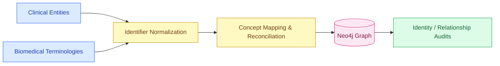
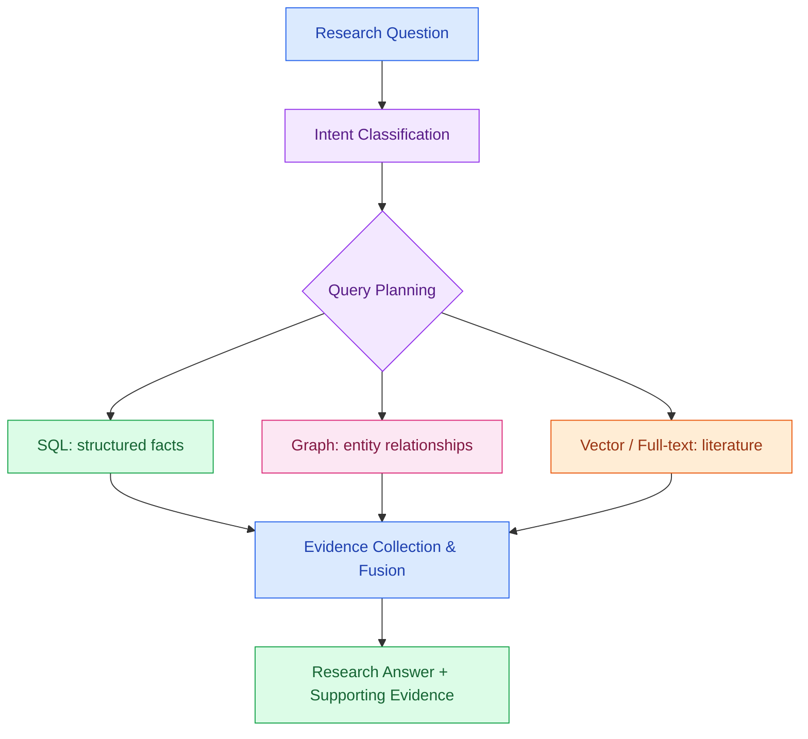

<div align="center">

# 🧬 CareScope
### An Intelligent, Self-Optimizing Healthcare Data & Biomedical Research Platform

**M.Tech Research Project | Database Management Systems · Machine Learning · Knowledge Graphs · Graph-RAG**

     

**From raw healthcare records to intelligent SQL optimization, biomedical knowledge graphs and evidence-oriented research retrieval.**

[Architecture](#-end-to-end-system-architecture) · [Implementation](#-implementation-roadmap) · [Research Contributions](#-research-contributions) · [Evaluation](#-experiments-and-results) · [Run](#-running-the-project)

> **Research prototype — not intended for diagnosis, treatment, or clinical decision-making.**

</div>

---

## 🎯 Project Overview

Modern biomedical research spans **structured clinical records**, **relationships among biomedical entities**, and **unstructured scientific literature**. A single database or retrieval method is rarely optimal for all three. CareScope explores an integrated architecture that **stores healthcare data, monitors and predicts SQL workload behavior, recommends performance optimizations, builds and validates a biomedical knowledge graph, and routes research questions across SQL, graph, and semantic retrieval backends**.

| Research question | Implemented approach | Why it matters |
|---|---|---|
| How can healthcare records be reliably stored and queried? | PostgreSQL schema, synthetic data ETL, integrity audits | Reproducible structured data foundation |
| How can expensive SQL queries be identified? | Query monitoring, execution-plan features, ML classification and regression | Evidence for workload-aware optimization |
| How can database performance be improved? | Hypothetical-index analysis, portfolio selection, controlled physical benchmarking | Compare candidate improvements before adoption |
| How can relationships between biomedical concepts be represented? | Neo4j graph construction, terminology normalization, identity reconciliation | Connect clinical and biomedical entities |
| How can research questions use different evidence types? | Literature ingestion, full-text/vector/graph retrieval and hybrid planner | Retrieve complementary evidence through appropriate backends |

## 🌈 End-to-End System Architecture

```mermaid
flowchart TB
    A["🧑‍⚕️ Synthetic Healthcare Records"]:::data
    B["📚 Biomedical Literature"]:::data
    C["🧾 ETL, Validation & Normalization"]:::process
    D[("🐘 PostgreSQL Clinical Store")]:::store
    E["📊 SQL Workload Generation & Monitoring"]:::process
    F["🧠 ML: Classification, Latency Prediction, Drift"]:::ai
    G["⚙️ HypoPG + Index Portfolio Advisor"]:::ai
    H["🧪 Controlled SQL Benchmarking"]:::evaluate
    I["🔗 Terminology & Identity Resolution"]:::process
    J[("🕸️ Neo4j Biomedical Graph")]:::graph
    K["📄 PDF Ingestion, Chunking & Indexing"]:::process
    L[("🔎 Full-text / Vector Literature Store")]:::store
    M["🧭 Cost-Aware Hybrid Query Planner"]:::ai
    N["🧩 SQL + Graph + Vector Retrieval"]:::graph
    O["📝 Evidence-Oriented Research Response"]:::output
    P["🌐 FastAPI / Research Interface"]:::output

    A --> C --> D
    D --> E --> F --> G --> H
    D --> I --> J
    B --> K --> L
    D --> M
    J --> M
    L --> M
    M --> N --> O --> P
    H -. performance profiles .-> M

    classDef data fill:#e0f2fe,stroke:#0284c7,color:#0c4a6e,stroke-width:2px
    classDef process fill:#fef3c7,stroke:#d97706,color:#78350f,stroke-width:2px
    classDef store fill:#dcfce7,stroke:#16a34a,color:#14532d,stroke-width:2px
    classDef ai fill:#f3e8ff,stroke:#9333ea,color:#581c87,stroke-width:2px
    classDef graph fill:#fce7f3,stroke:#db2777,color:#831843,stroke-width:2px
    classDef evaluate fill:#ffedd5,stroke:#ea580c,color:#7c2d12,stroke-width:2px
    classDef output fill:#ccfbf1,stroke:#0d9488,color:#134e4a,stroke-width:2px
```

**Architecture rationale:** relational databases are effective for structured joins and aggregates; graphs express entity relationships; vector retrieval finds semantically similar passages. The hybrid planner brings these complementary methods under one research workflow. The diagram is a **system-level architecture**, not a claim that every component is automatically deployed in one process.

## 🛠️ Technology Stack

| Layer | Technologies and techniques |
|---|---|
| Data engineering | Python, pandas, CSV processing, synthetic healthcare data |
| Relational data | PostgreSQL, SQL, execution plans, statistics |
| Workload intelligence | Feature engineering, supervised ML, clustering, anomaly/drift analysis |
| Optimization | HypoPG, candidate-index ranking, greedy/beam portfolio search, physical benchmarks |
| Knowledge graph | Neo4j, Cypher, terminology normalization, relationship validation |
| Literature intelligence | PDF extraction, text chunking, full-text search, embeddings, pgvector / SQLite components |
| Integration | Hybrid SQL/graph/vector planner, FastAPI, diagnostic and validation scripts |

## 🧩 Implementation Roadmap

The repository contains experimental iterations as well as refined scripts. The mapping below highlights **representative implementation files**, not every intermediate version.

| Workstream | Core files in `notebooks/` | What is implemented | Research deliverable |
|---|---|---|---|
| **01 · Data foundation** | `01.py`, `02.py`, `02_audit.py` | Data inspection, schema/ETL, relational integrity auditing | Queryable healthcare database and checks |
| **02 · Workload generation** | `03.py`, `09.py` | Representative clinical and administrative SQL templates | Repeatable query workload |
| **03 · Monitoring** | `04.py`, `07_monitoring.py`, `07_update.py` | Query timing, plan feature extraction, repeated resource measurements | Workload observations and execution features |
| **04 · ML intelligence** | `05.py`, `08_full.py`, `08_v6_final.py`, `08_v6_diagnosis.py` | Query classification, latency prediction, grouped validation, diagnostics | Model evaluation pipelines |
| **05 · Optimization** | `06.py`, `09_index.py`, `09_optimizer.py`, `10_2.py`, `improve_v6_v7.py` | Index candidates, hypothetical plans, portfolio search, physical comparisons | Optimization recommendations and benchmark methods |
| **06 · Scale studies** | `05_scaling.py`, `05_full.py`, `08_scaling.py`, `08_scaling_50k.py` | Scaled data/workload generation and comparative analysis | Scalability experiment workflows |
| **07 · Knowledge graph** | `07.py`, `11.py`, `11_4.py`, `11_5_3.py`, `phase10_identity_bridge.py` | Biomedical graph, terminology reconciliation, SQL↔graph identity checks | Graph entities and consistency audits |
| **08 · Literature layer** | `12_full.py`, `phase11_pgvector.py`, `phase11_incremental.py` | Document processing, chunk indexing, semantic retrieval | Searchable literature corpus |
| **09 · Graph-RAG** | `phase12_graph_rag.py`, `phase12_graph_rag_v7.py` | Full-text, vector and graph retrieval with result fusion | Multi-source research evidence retrieval |
| **10 · Hybrid planning** | `13.py`, `phase13_hybrid_query_planner.py`, `phase13_api.py` | Query classification, backend selection, orchestration and API | Hybrid research query service |
| **11 · Verification** | `phase13_graph_comparison.py`, `phase13_unseen_validation.py`, `test_phase13_planner.py`, `system_health_check.py` | Retrieval comparisons, unseen question checks, tests, connectivity diagnostics | Validation and reproducibility tools |

### Flow 1 — Intelligent Database Optimization


**Why this is done:** database execution plans and runtime measurements can guide index decisions. Hypothetical indexes reduce the cost of exploring candidate designs; physical benchmarks then assess whether improvements are observed in practice.

### Flow 2 — Biomedical Knowledge Graph



**Why this is done:** biomedical entities often have multiple names or identifiers. Explicit mapping and validation help prevent incorrect joins between SQL records, graph nodes and terminology references.

### Flow 3 — Hybrid Biomedical Research Retrieval



**Why this is done:** a patient count, a graph relationship and a literature similarity question have different computational characteristics. Routing allows the research system to use the relevant backend(s) rather than forcing all questions into one query paradigm.

## ✨ Research Contributions

1. **Workload-aware database intelligence:** an experimental pipeline from SQL telemetry to ML-assisted classification, latency modeling and diagnostics.
2. **Evidence-driven index exploration:** hypothetical candidate analysis combined with physical benchmarking and portfolio-level search.
3. **Cross-database biomedical identity alignment:** reconciliation and auditing across relational records and knowledge-graph entities.
4. **Multi-source biomedical retrieval:** a Graph-RAG research workflow combining lexical, semantic and relationship evidence.
5. **Hybrid query orchestration:** query-intent analysis, backend planning, API integration and independent validation scripts.
6. **Reproducible evaluation structure:** separate diagnostics for performance, scale, drift, semantic mappings and retrieval behavior.

These are **implemented research directions and software contributions**. Claims of superiority over external baselines require corresponding measured comparisons.

## 📈 Experiments and Results

### Implemented evaluation capabilities

| Experiment | Measurements / artifacts supported | Interpretation |
|---|---|---|
| SQL workload profiling | Latency, execution plans, resource statistics | Characterize workload behavior |
| ML workload modeling | Classification metrics, regression errors, grouped validation | Evaluate prediction quality and generalization |
| Scaling studies | Data-size and workload comparisons | Examine scalability trends |
| Index advisory | Hypothetical planner costs, physical query timings, bootstrap intervals | Evaluate candidate performance gains |
| Graph consistency | Identifier matching, terminology and relationship checks | Assess data alignment |
| Literature retrieval | Full-text/vector/graph result comparisons | Analyze evidence retrieval behavior |
| Hybrid planning | Route decisions, cost profiles, unseen-question tests | Evaluate orchestration and robustness |

### Results presentation guidance

The source archive establishes **implemented experiment pipelines**, but does not contain a complete verified numerical results bundle. Accordingly, this README does **not invent** accuracy, speedup, p-values, retrieval scores or latency numbers. When running the experiments, report measured results in the following format:

| KPI | Report from |
|---|---|
| ML classification accuracy / macro-F1 | `08_v6_final.py` and its generated evaluation reports |
| Latency prediction MAE / RMSE | `08_full.py` / `08_v6_final.py` outputs |
| Median / p95 SQL latency before vs. after indexing | `09_final.py` / `10_2.py` benchmark artifacts |
| Index improvement with confidence interval | `10_2.py` bootstrap comparisons |
| Graph identifier match and validation counts | `11_5_3.py` and bridge audit outputs |
| Retrieval quality and query routing outcomes | Phase 12/13 comparison and validation reports |

> **Project outcome:** A multi-layer research codebase has been developed covering relational data management, intelligent query analysis, index optimization, graph construction, literature retrieval and hybrid query planning. Numerical performance conclusions should be drawn from reproducible benchmark outputs for the specific dataset and environment used.

## 🗂️ Repository Structure

```text
.
├── notebooks/
│   ├── 01.py, 02.py, 02_audit.py       # Database foundation / ETL
│   ├── 03.py, 04.py                   # Workloads / monitoring
│   ├── 05*.py, 08*.py                 # ML and scaling experiments
│   ├── 06*.py, 09*.py, 10*.py         # Optimization and benchmarking
│   ├── 07.py, 11*.py                  # Biomedical graph / validation
│   ├── phase10_identity_bridge.py     # SQL–graph entity alignment
│   ├── 12_full.py, phase11_*.py       # Literature ingestion / vectors
│   ├── phase12_graph_rag*.py          # Graph-RAG retrieval
│   ├── 13.py, phase13_*.py            # Hybrid planner / API / tests
│   └── system_health_check.py        # Connectivity diagnostics
└── README.md
```

Some file names reflect experimental revisions; consult the latest validation reports before selecting a version for a demonstration.

## 🚀 Running the Project

**Prerequisites:** Python environment with the project dependencies, accessible PostgreSQL and Neo4j instances, and prepared datasets/literature indexes for the selected workflow. Configure connection settings through local environment variables; **never commit credentials**.

From the project root:

```bash
# Check the environment and service connections
python notebooks/system_health_check.py

# Test the hybrid query planner with a research question
python notebooks/phase13_hybrid_query_planner.py --question "Which kidney lab tests are associated with hypertension?"

# Run planner validation
python notebooks/phase13_unseen_validation.py

# Run graph comparison experiment
python notebooks/phase13_graph_comparison.py --repeats 3
```

To expose the API, start from the `notebooks` directory:

```bash
cd notebooks
uvicorn phase13_api:app --host 127.0.0.1 --port 8013 --reload
```

API documentation: **http://127.0.0.1:8013/docs**. Commands require the relevant dependencies and backing services; a successful start depends on local configuration.

## 🔬 Research Scope and Responsible Use

CareScope uses synthetic/experimental healthcare data and biomedical research retrieval techniques. Graph associations are **not causal evidence**. Retrieved passages and generated summaries must be checked against their sources. This system is designed for **academic research and software evaluation**, not patient care or clinical recommendations.

---

<div align="center">

### 🧬 CareScope · Intelligent Data Infrastructure for Biomedical Research

**PostgreSQL × Machine Learning × Neo4j × Graph-RAG × Hybrid Query Planning**

*M.Tech Research Project · Database Systems and Applied AI*

</div>
